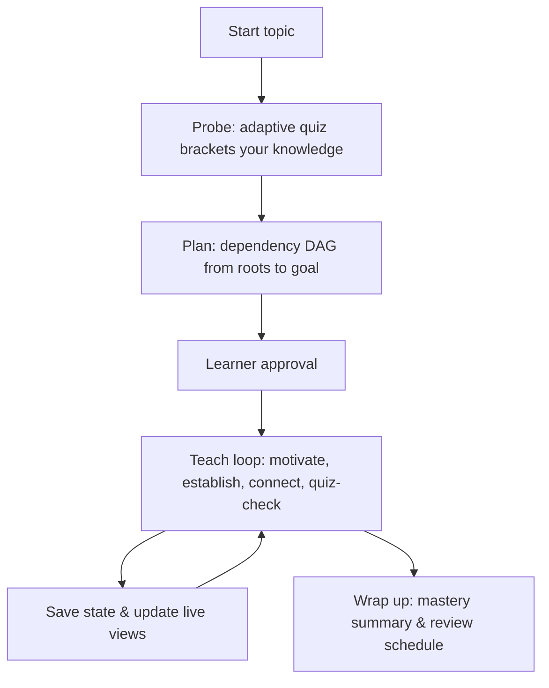

# learn

An AI tutor for [Google Antigravity (AGY)](https://antigravity.google) and local ChatGPT Work that teaches any topic for **deep understanding**, not rote memorization.

`learn` probes what you already know, maps out a dependency graph from first principles to your target goal, walks you through motivated discoveries with quizzes, and tracks your retention across sessions using spaced-repetition review. AGY uses native modal quizzes; ChatGPT Work uses questions and answers in chat. Both share the same saved progress.

---

## Highlights

- **First-Principles Pedagogy:** Grounded in unconditional truths and motivated discoveries (3Blue1Brown style).
- **AGY-Native Interactive Quizzes:** Questions appear as native modal popups (`ask_question`) with structured diagnostic feedback (why an answer is right or wrong, and what misconceptions it indicates).
- **Live Visual Artifacts:** Real-time visual dependency DAG (`learning-map.md`) and running journal (`lesson-notes.md`) updated after every node.
- **Persistent Progress:** State is saved to repository markdown files (`topics/<topic-slug>/`) after every quiz and lesson—new conversations pick up seamlessly right where you left off.
- **Spaced-Repetition Review:** Built-in review scheduler (1 → 3 → 7 → 14 → 30 → 60 days) to lock in knowledge over time.
- **Applied Practice:** Dedicated practice mode for transfer problems, code exercises, and language writing drills.
- **Fact Verification:** Built-in research subagent verification stops hallucinations before they reach your mental model.

---

## Quick Start

### ChatGPT Work (desktop, local files)

1. Open the ChatGPT desktop app and select **Work**.
2. Create or select a local project and attach this repository folder. Use it as the primary folder, and choose local execution or an eligible Work task with local computer access. The task needs permission to read these skills and read/write `topics/`.
3. Start a new chat in that project and say: **"Use the teach skill in `.agents/skills/teach/SKILL.md`. Teach me binary numbers."** If the skill is listed in the selector, you can also select it with `@teach`. Direct review and practice requests use the same folder.

Work asks one probe/lesson question at a time in chat and waits for your answer. Review can use a numbered batch (reply, for example, `1B, 2D, 3: don't know`). The tutor links to your saved `map.md` and `log.md` as the learning map and lesson notes; it opens them alongside the chat when a file-preview tool is available. Unfinished questions are saved so they can be resumed.

Continue with **"continue binary numbers"**, **"review binary numbers"**, or **"practice binary numbers"**. You can use the same topic later in AGY; there is no progress conversion. Keep one active learning session per topic to avoid conflicting edits.

This setup uses the existing repository skills and files, with no plugin or API key needed. Standalone skills are supported in the desktop app; this is not an upload-only cloud setup. Local access must be available for the task. See the official OpenAI documentation for [skills](https://learn.chatgpt.com/docs/build-skills), [local projects](https://learn.chatgpt.com/docs/projects), and [Work execution options](https://learn.chatgpt.com/docs/get-started-with-work).

Codex can use the same skills and chat interaction rules when opened in this folder. `AGENTS.md` provides the learning entry point; AGY retains its always-on rule below.

### Antigravity CLI (unchanged launch)

#### Requirements
- **Antigravity CLI (`agy`)**: Installed and signed in (any Gemini plan supported by Antigravity).
- No extra dependencies, Node packages, or external API keys needed.

#### Launching

```bash
git clone <your-repo-url> learn
cd learn
agy
```

Start studying by saying:

> `teach me binary numbers`

On your first run with a new topic, the tutor guides you through three quick steps (**Topic → Goal → Level**), constructs a dependency map, and waits for your confirmation before starting lessons.

> [!TIP]
> The workspace rule automatically activates the tutor. You can also explicitly say: *"use the teach skill"*.

The platform instructions are implemented, but live UI verification is still pending for both AGY and ChatGPT Work. The checklist and recorded static checks are in [docs/verification.md](docs/verification.md).

---

## How It Teaches

The teaching approach is built on two core principles:

1. **Unconditional Truths First:** Begin with foundational facts you can accept as-is without caveats or nuance. Small, solid foundations beat large, shaky assumptions.
2. **"How Could I Have Discovered This?":** Every new concept is motivated from a real problem rather than handed down as an arbitrary rule. Knowledge feels discovered rather than decreed.

### The Session Cycle: Probe → Plan → Teach



- **Probe:** Diagnostic questions locate your frontier on every relevant strand (finding what you know and where your edge is).
- **Plan:** A clean, minimal dependency DAG mapping roots to your goal. The agent stops and waits for your approval before proceeding.
- **Teach:** For each node:
  1. *Motivate* (why do we need this right now?),
  2. *Establish* (derive or declare unconditionally),
  3. *Connect* (link explicitly to previous nodes),
  4. *Quiz-Check* (a quiz confirming the idea landed).

---

## Commands & Interactions

| What You Say | What Happens |
|---|---|
| `teach me <topic>` | Starts a new topic (guided onboarding) or presents the start card for an existing topic |
| `continue <topic>` | Resumes where you left off (including unfinished plans or in-progress lessons) |
| `review <topic>` | Runs a spaced-repetition review quiz on shaky and due nodes |
| `practice <topic>` | Generates applied exercises, transfer problems, or language writing prompts |
| `wrap up` / `stop` | Concludes the session with a mastery summary and upcoming review dates |
| `<another topic>` | Switches topics cleanly—current progress is saved automatically |

If you enter without naming a topic, `learn` lists your existing topics and asks whether to resume one or start something new.

---

## What a Session Looks Like

### 1. Interactive Quizzes
In AGY, quizzes trigger Antigravity's `ask_question` dialog. In ChatGPT Work, the same quiz is shown in chat and the tutor waits for your reply. Options present bare claims with randomized positions and diagnostic distractors. Upon answering, you receive a breakdown:

```markdown
✅ Correct
Answer: The place value is 2^n because each additional bit doubles the state space.
Why: Each bit doubles the count of distinguishable combinations.
What this tells me: Confirms your foundational model of binary states is solid.
```

### 2. Live Artifacts
During the session, two live artifacts keep your context visible:
- **`learning-map.md`**: An interactive Mermaid diagram with color-coded nodes:
  - 🟢 **`locked-in`** (mastered and confirmed)
  - 🟠 **`shaky`** (missed or needs remediation)
  - ⚪ **`untaught`** (upcoming nodes)
- **`lesson-notes.md`**: A running log of lessons, derived insights, and quiz recaps.

Those artifact names apply to AGY. ChatGPT Work displays the underlying topic's `map.md` and `log.md` directly, with a small inline diagram or readable dependency list when needed.

### 3. Returning Start Card
When you return to a topic, you see a quick status overview:

```text
📚 Binary numbers
Goal: convert small integers and explain place value
Progress: 3/6 nodes locked in · 1 shaky · 2 due for review
Next: Converting decimal to binary
```

---

## Persistent Memory & State

Because AI agents have no memory across conversations, `learn` maintains persistent state in plain Markdown within the repository:

```
topics/<topic-slug>/
  profile.md   # Goal, learning preferences, assessed floor/ceiling per strand
  map.md       # Dependency DAG, node status, and spaced-repetition schedules
  log.md       # Chronological session history, quiz answers, and corrections
```

- **Write-as-you-go:** Every quiz result and lesson updates the repository files immediately. If your session is interrupted, no progress is lost.
- **Portability:** Check `topics/` into git to sync your learning progress across machines. Complete schemas are detailed in [topics/README.md](topics/README.md).

### Spaced Repetition Schedule

When reviewing nodes (`learn-review`):
- Passing advances the review interval: **1 → 3 → 7 → 14 → 30 → 60 days**.
- Missing marks the node **`shaky`** and resets its review interval to 1 day.

---

## Workspace Layout

```
AGENTS.md                    # Learning entry point for local OpenAI sessions
.agents/
  rules/
    learning.md              # Always-on rule: configures AGY as an active learning workspace
  skills/
    teach/SKILL.md           # Shared pedagogy, platform interactions, quiz rules
    visualize/SKILL.md       # Diagram generation (Mermaid default; Draw.io support)
    learn-review/SKILL.md    # Spaced-repetition review engine and quiz batching
    learn-practice/SKILL.md  # Applied exercises, transfer challenges, language drills
topics/
  README.md                  # State file schemas and scheduling specifications
  <topic-slug>/              # Persistent state per topic
docs/
  implementation_plan.md     # Architectural plan and migration roadmap
  verification.md            # Verification protocol and test cases
agents/ extensions/ skills/  # Preserved original pi configuration (dual-compatibility)
```

---

## Options & Customization

- **Obsidian Support:** Plain markdown by default. Set `Obsidian embeds: on` in a topic's `profile.md` to format attachments with `![[file.png]]`.
- **Diagrams:** Inline Mermaid diagrams are rendered natively. Draw.io MCP integration is supported for editable architecture diagrams.
- **Tailor the Tutor:** Customize prompt instructions or pedagogical pacing by editing [.agents/skills/teach/SKILL.md](.agents/skills/teach/SKILL.md).

---

## Background & Credits

This workspace adapts the original pi system for AGY and local ChatGPT Work. It is inspired by [**amosblomqvist/learn**](https://github.com/amosblomqvist/learn), created by Amos Blomqvist and showcased in the video [How I Use AI to Learn Things](https://www.youtube.com/watch?v=kzcI5F4tGiU).

[](https://www.youtube.com/watch?v=kzcI5F4tGiU)

### Original pi Architecture vs. AGY-Native Design

- **Pedagogy:** The core teaching philosophy (unconditional truths, motivated discovery, adaptive probing) originates from Amos Blomqvist's work.
- **AGY Adaptation:** While the original system was built for the [pi](https://github.com/earendil-works/pi) terminal assistant using custom terminal UI extensions (tmux popups and subagents), this repository rebuilds the experience natively on **Antigravity (AGY)** using native skills, `ask_question` modals, live UI artifacts, and persistent file-backed state.
- **Dual Compatibility:** The original pi files in `agents/`, `extensions/`, and `skills/` are preserved untouched, allowing this repo to function both as an AGY workspace and as a `.pi` directory.
- **ChatGPT Work:** The shared `.agents/skills/` instructions also support local Work with chat quizzes, file previews, and the same persistent state. AGY's modal and artifact paths remain supported.
