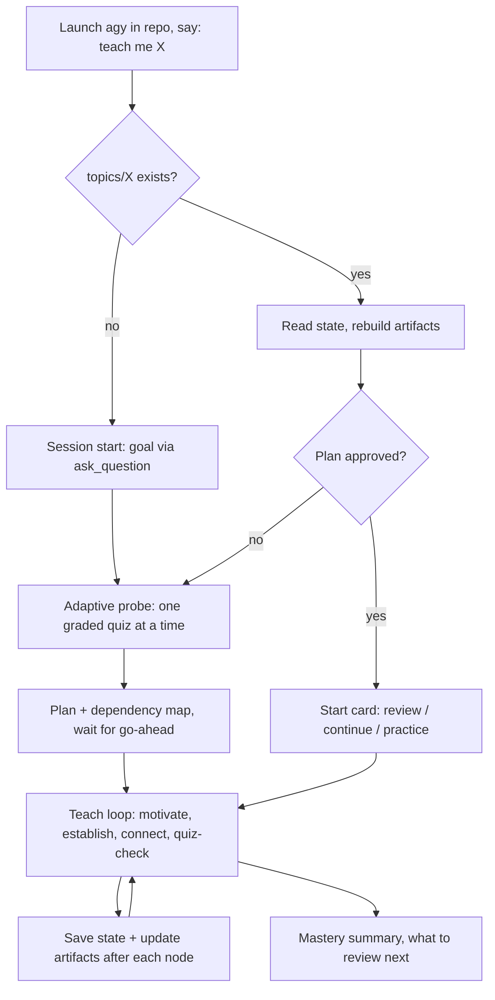

# Implementation Plan: AGY-native "learn" (v2)

Make this repo work with Antigravity (AGY) on a Gemini Pro plan, with a learning experience as polished as the pi version, using the AGY features agreed in chat.

## Review of v1: what changed

| v1 problem | v2 fix |
|---|---|
| Artifacts were only an "if it renders" fallback | **Live artifacts are the main UI** (`learning-map.md`, `lesson-notes.md`). Repo files are the persistent memory behind them. |
| Built custom PNG maker subagents (`run_command` + `view_file` render loop) | Dropped. **Mermaid first**, as decided. `drawio` MCP and `image-generator` are optional extras. |
| Practice mode reduced to a "language notes" footnote | Practice mode is a real deliverable. |
| No batching rule for review quizzes | One adaptive question at a time when probing; **batched** questions in review. |
| Moved pi files to `legacy-pi/`, which breaks the pi setup | **Pi files stay in place.** The AGY layer is added beside them, so the repo works with both. |
| Three open decisions | Resolved (see below). |

## Decisions (resolved)

1. **Obsidian:** plain markdown by default. Obsidian embeds and wikilinks are an opt-in setting.
2. **Diagrams:** inline mermaid first. The PNG renderer is deferred.
3. **Location:** this repo is the learning folder.

## Feature mapping (the agreed design)

| pi feature | AGY implementation |
|---|---|
| Quiz popup with ✓/✗ | `ask_question` modal. Agent grades the answer and replies with a **result block**: ✅/❌, correct answer, explanation, and what a miss says about your model. |
| Question popups | `ask_question` directly (single-select, multi-select, write-in). |
| Dependency map | **Live artifact `learning-map.md`**: mermaid graph, nodes colored by status (locked-in / shaky / untaught), updated after every node. |
| Lesson notes and session log | **Live artifact `lesson-notes.md`** that builds up during the session, plus `topics/<slug>/log.md` in the repo (Obsidian-readable). |
| SVG / mermaid makers | Mermaid renders natively. Optional: `drawio` MCP for richer diagrams, `image-generator` subagent for illustrations. |
| Researcher | Built-in `research` subagent, briefed in the original researcher's report format. |
| Math | LaTeX in markdown. |

## Key design point: artifacts vs. repo files

Artifacts live in each conversation's own folder, so **a new conversation can't see the old one's artifacts.** So:

- **Source of truth:** `topics/<slug>/profile.md`, `map.md`, `log.md` in the repo.
- **Live view:** at the start of each session the agent rebuilds the `learning-map.md` and `lesson-notes.md` artifacts from those files. After each quiz or node it updates **both** the repo file and the artifact.
- **Write-as-you-go:** state is saved after every quiz result and every node. Closing the terminal mid-lesson loses nothing.

## Target layout

```
learn/
  .agents/
    rules/
      learning.md              # always_on: "this is a learning workspace; use teach; state lives in topics/"
    skills/
      teach/SKILL.md           # method + session flow + quiz format + state protocol
      visualize/SKILL.md       # when to draw; mermaid default; drawio/image-generator optional
      learn-review/SKILL.md    # review mode (batched quizzes on shaky / stale nodes)
      learn-practice/SKILL.md  # practice mode (applied exercises, writing practice for languages)
  topics/
    README.md                  # file schemas
    <topic-slug>/
      profile.md               # goal, per-strand edge (floor/ceiling), preferences
      map.md                   # mermaid DAG + node status + last_reviewed + next node
      log.md                   # lessons, quiz results, misconceptions, research corrections
  agents/ extensions/ skills/  # original pi files, unchanged
  docs/                        # this plan + verification checklist
  README.md                    # AGY-first; credits and links the original pi version
```

## Session flow



- **Switching topics:** name another topic at any time. With no topic named, the agent lists `topics/` and asks which one, or offers to start a new one.

## Guided experience features

### 1. Session start flow (topic → goal → level)
- **New topic:** three guided steps.
  1. **Topic:** confirm the topic and create `topics/<slug>/`.
  2. **Goal:** use `ask_question` to make the goal concrete (what you want to be able to do or understand, and why).
  3. **Level:** run the adaptive graded probe to find your edge on each strand.

  The flow ends with the plan and the map, then waits for your go-ahead.
- **Returning topic:** a **start card** showing topic, goal, nodes locked-in out of total, nodes due for review, and the next node. Then it offers: review the due nodes first, continue, or practice.

### 2. Mastery summary (end of session)
Shown when you say "stop" or "wrap up", or when the map is finished. It's saved to `log.md` and `lesson-notes.md`.
- Nodes taught this session and their status.
- Quiz recap: right and wrong, with the misconception behind each miss.
- Any research corrections made during the session.
- **What to review next:** shaky nodes plus nodes that come due soon, with dates.

### 3. Review mode with spaced repetition
- Each node in `map.md` stores `status`, `last_reviewed`, `interval_days` and `next_review`.
- **Schedule:** a correct review moves a node to the next interval (1 → 3 → 7 → 14 → 30 → 60 days). A miss marks it **shaky** and resets it to 1 day.
- **Trigger:** the returning-topic start card lists the due nodes and offers review first. You can also say "review X" at any time (`learn-review` skill).
- **Format:** one batched `ask_question` with several questions on the due nodes, then a single result block per question.
- **Languages:** vocab and grammar items can be tracked as small nodes using the same schedule. That covers the spaced-repetition piece, with writing practice in `learn-practice`.

## Quiz rules (in `teach`)

- Keep the original option-construction procedure: bare claims, mutate the correct claim into distractors, no asymmetric bolding.
- **Randomize the correct option's position.** Always include a "Don't know" option.
- Probing: **one adaptive question per call**. Review mode: **batch** several questions in one `ask_question` call.
- Every answer gets the result block. Each result is logged to `log.md` and updates the node's status.

## Phases

### Phase 1: Port `teach` and `visualize` to AGY
- [x] `.agents/rules/learning.md` (always-on pointer).
- [x] `teach`: keep the philosophy, both principles, and probe/plan/teach. Neutral "you" voice. Tool names → `ask_question`, `research`.
- [x] `visualize`: keep the "when / when not" guidance. Mermaid inline default. Optional `drawio` / `image-generator` with the same "one idea, fewest elements, verify correctness" rules.
- [x] Optional Obsidian setting (embeds/wikilinks off by default).

### Phase 2: Live learning map and graded quiz format
- [x] `topics/README.md` with the `profile.md` / `map.md` / `log.md` schemas.
- [x] Mermaid status styling (`classDef locked/shaky/untaught`).
- [x] Artifact rebuild-on-start and dual update (repo file + artifact).
- [x] Result-block template and quiz rules above.
- [x] Session start card and mastery summary templates.

### Phase 3: Researcher and diagram subagents
- [x] Researcher briefing template for the built-in `research` subagent (Summary / Findings / Sources / Gaps), and when it must be used (any uncertain fact; scoping in Phase 2 of a lesson).
- [x] Optional diagram helper defined via `define_subagent` inside `visualize`, only for `drawio` diagrams. Mermaid needs no subagent.

### Phase 4: Review and practice modes
- [x] `learn-review`: pick shaky and due nodes, run a batched quiz, then apply the interval schedule (update `status`, `last_reviewed`, `interval_days`, `next_review`).
- [x] `learn-practice`: applied problems per node. For languages: writing prompts with corrections, vocab spaced review.

### Phase 5: Docs and verification
- [x] README rewritten AGY-first (setup, launching, the flow, switching topics), crediting and linking the original pi version.
- [x] Static audit: skill frontmatter, state recovery and scheduling rules, artifact refresh protocol, and optional diagram-helper briefing.
- [x] Repeatable live verification checklist in `docs/verification.md` with expected outcomes and evidence requirements.
- [ ] Dry run on a small topic (e.g. "binary numbers"): probe, plan, teach two nodes, stop.
- [ ] **New conversation:** confirm the start card, review and resume are correct, and the artifacts are rebuilt.
- [ ] Switch to a second topic and back. Confirm the states stay isolated.

## Risks

> [!WARNING]
> - **Artifact display in the `agy` CLI** isn't verified yet. If artifacts don't render well, the same mermaid map is shown inline in chat. The repo files are unaffected.
> - **Skill auto-triggering:** the always-on rule is the safety net. Saying "use teach" also works.
> - **Quiz feel:** there's a grading round-trip after each answer, so it's less instant than pi's popup.

---

## Build status (updated 2026-10-05)

Phases 1 to 4 and the README are **implemented at the instruction/configuration level**; interactive AGY behavior is not yet verified. Files created:
`.agents/rules/learning.md`, `.agents/skills/{teach,visualize,learn-review,learn-practice}/SKILL.md`, `topics/README.md`, README "Using with AGY" section.

**Audit continued on 2026-10-05.** Corrected incomplete-session recovery, rebuilding both artifacts from persistent state, initialization for direct review/practice, untaught-node dates, small review batches, per-node batch outcomes, same-day interval advancement, and corrective retry scheduling. Added the missing transient drawio-helper brief. Narrowed skill triggering so repo maintenance does not start learner onboarding. The original pi files remain untouched.

**Local checks:** AGY is installed and `agy --help` succeeds. `agy agents` exits without a listing, so agent availability is unconfirmed. All four skills pass the skill-creator frontmatter validator with Python UTF-8 mode. These checks do not exercise modal quizzes or artifact rendering.

**Remaining: live verification.** Follow [verification.md](verification.md). The three unchecked items in Phase 5 need a live `agy` session:
1. Dry run on a small topic (e.g. "binary numbers"): probe, plan, teach two nodes, stop.
2. Open a **new conversation**: confirm the start card, review and resume work, and the artifacts are rebuilt from the repo files.
3. Switch to a second topic and back: confirm states stay isolated.

Things to check during that run: whether skills auto-trigger (the always-on rule is the fallback; "use the teach skill" also works), whether artifacts render in the `agy` CLI (else the map is shown inline), and how the `ask_question` quiz feels. Fix anything in `.agents/skills/*/SKILL.md`.

Deferred by decision: PNG diagram rendering (mermaid inline only for now).
