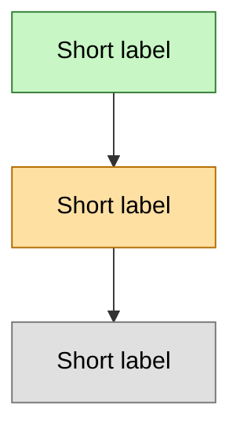

# topics/

One folder per topic you study. This is the **persistent memory** of the learning system: the AI has no memory between conversations, so it reads these files at the start of every session and writes them after every quiz result and taught node.

```
topics/
  <topic-slug>/        # lowercase-kebab, e.g. linear-algebra, spanish
    profile.md
    map.md
    log.md
```

## `profile.md`

```markdown
# <Topic>

- **Created:** YYYY-MM-DD
- **Goal:** what the learner wants to be able to do or understand, and why
- **Mode preference:** socratic | expository | adaptive
- **Session phase:** goal   <!-- goal | probe | plan | teach; teach means the plan was approved -->
- **Obsidian embeds:** off   <!-- set to "on" to use ![[file.png]] style embeds -->

## Level (from probing)

| Strand | Floor (knows at least) | Ceiling (runs out here) |
|--------|------------------------|-------------------------|
| ...    | ...                    | ...                     |

## Known misconceptions
- ...
```

## `map.md`

The dependency graph. Unconditional truths at the roots, the learner's goal at the sink.

````markdown
# Map: <Topic>

- **Next node:** <node id>
- **Updated:** YYYY-MM-DD



## Nodes

| id | label | status | last_reviewed | interval_days | next_review |
|----|-------|--------|---------------|---------------|-------------|
| n1 | ...   | locked-in | 2026-01-01 | 3 | 2026-01-04 |
| n2 | ...   | shaky | 2026-01-01 | 1 | 2026-01-02 |
| n3 | ...   | untaught | | 0 | |
````

- **status:** `locked-in` | `shaky` | `untaught`
- **Untaught nodes:** blank review dates and `interval_days = 0`; never select them for review or practice. During goal/probe, the map may have no nodes yet and `Next node: none`.
- **Spaced repetition:** use the learner's local calendar date (ISO `YYYY-MM-DD`), not an assumed UTC date. A correct independent review of a locked-in node advances `interval_days` along 1 → 3 → 7 → 14 → 30 → 60 (stay at 60). Correct recovery of a shaky node restores `locked-in` at 1 day. A miss or "Don't know" makes it `shaky` at 1 day. Set `last_reviewed = today` and `next_review = today + interval_days` in all assessed cases.
- A newly taught node's first quiz-check sets `interval_days = 1` and review dates whether it passes (`locked-in`) or misses (`shaky`). Probe results before the map exists go into the log and profile's Level table; they are not taught-node results.
- Advance spacing at most once per node per local day. A repeat correct answer that day keeps its interval; any miss resets it to 1. Successful corrective retries stay at 1 day, even after the status returns to `locked-in`. Log each answer, but never apply multiple interval advances for multiple questions in a review batch. Any miss in a node's batch takes precedence over correct answers.
- An unanswered or canceled question changes no status or dates. A hinted answer or a copied solution does not establish independent mastery.
- Keep the mermaid class on each node in sync with the table's `status`.
- **Next node:** the first untaught node in dependency order whose prerequisites are locked-in. If a shaky prerequisite blocks progress, select it for remediation first. Use `complete` only when no untaught node remains; shaky/due nodes can still require review. Update the map's `Updated` date on every state change.

## Session and artifact recovery

Create all three files when starting a topic, with `Session phase: goal`, an empty node table, and an initial session log heading. Save the goal before moving to `probe`; save probe observations as answers arrive; save the dependency map before moving to `plan`; record the learner's approval before moving to `teach`. On restart, resume the saved phase rather than treating an incomplete folder as a finished plan. For older profiles without the field, infer it from the map and approval log; do not reset existing progress.

`learning-map.md` mirrors the current topic's complete `map.md`; `lesson-notes.md` is rebuilt from its `log.md` with the topic title. Both live in the artifact directory supplied by the current conversation. Rebuild both on every session start, direct review/practice invocation, and topic switch. Save the repository files before refreshing these views so an interrupted artifact write can be repaired from persistent state. When artifacts are unavailable, show the same map and relevant notes inline.

Topic switches replace the live views; they never combine profiles, maps, or logs. The log remains append-only, including failed quizzes and corrective retries.

## `log.md`

Append-only. Newest entry last.

```markdown
## YYYY-MM-DD — Session N

### Lesson: <node label>
Short notes of what was taught (the motivated path, the key connection).

### Quiz results
- ❌/✅ **<node id>** — <question gist> — answered: <x> — correct: <y> — misconception: <if any>

### Research corrections
- ...

### Mastery summary
(written at session end)
```
