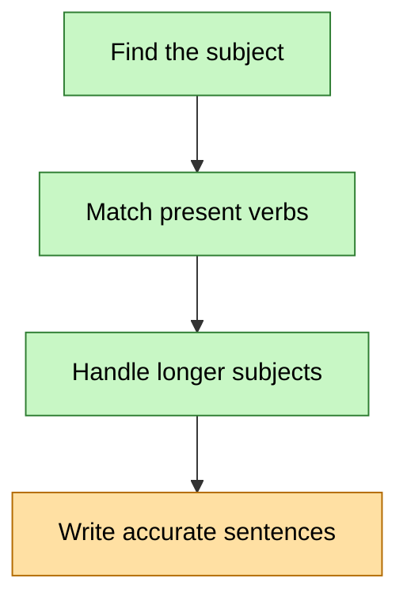

# Map: IELTS preparation

- **Next node:** n4
- **Updated:** 2026-10-16

First block: accurate sentences for IELTS writing. The wider goal remains IELTS Academic overall 7.0 with no section below 6.5 for master's scholarship applications; exact programme requirements will be checked when shortlisted.

First writing block initially completed on 2026-10-16. n3 recovered through PR5, with correct mixed-subject agreement again in PR8. n4's sentence structure improved in PR7/PR8; wording and fulfilling PR8's requested benefit/difficulty contrast remain under revision in PR9. n4 retains shaky pending that revision. All four taught nodes are due for review on 2026-10-17. The wider IELTS goal remains active; later blocks require their relevant diagnostics.

## Nodes

| id | label | status | last_reviewed | interval_days | next_review |
|----|-------|--------|---------------|---------------|-------------|
| n1 | Find the subject: head, person and number in simple declarative sentences | locked-in | 2026-10-16 | 1 | 2026-10-17 |
| n2 | Match present verbs: I/you/we/they, third-person singular, and be | locked-in | 2026-10-16 | 1 | 2026-10-17 |
| n3 | Handle longer subjects and relative clauses without losing agreement | locked-in | 2026-10-16 | 1 | 2026-10-17 |
| n4 | Independently write and check accurate IELTS-topic sentences | shaky | 2026-10-16 | 1 | 2026-10-17 |
